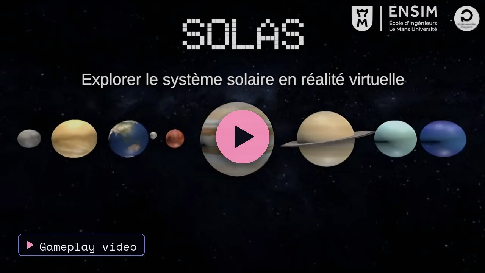
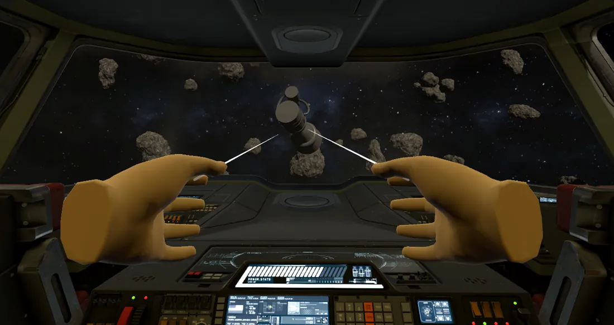
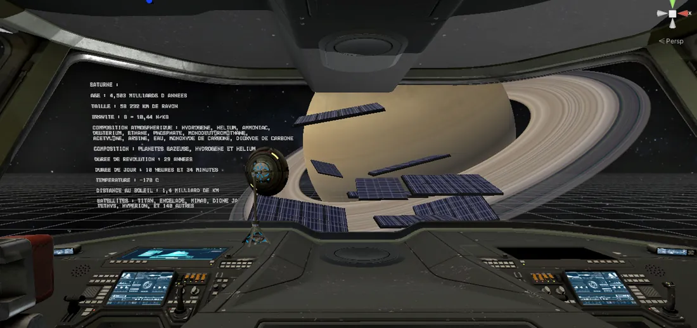
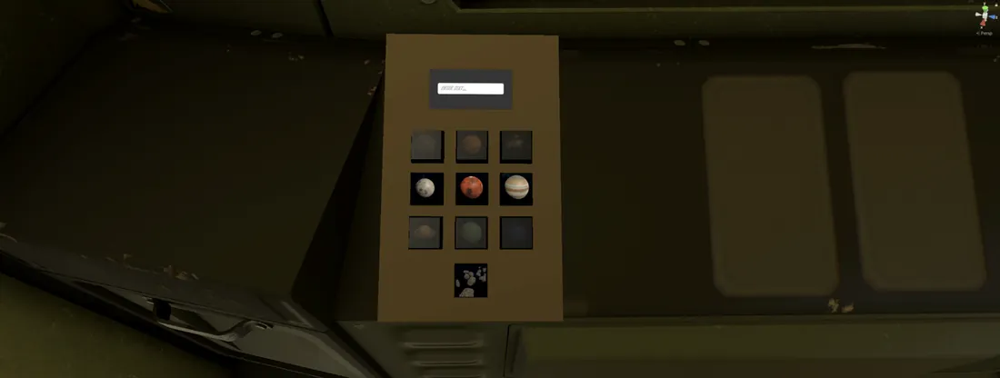
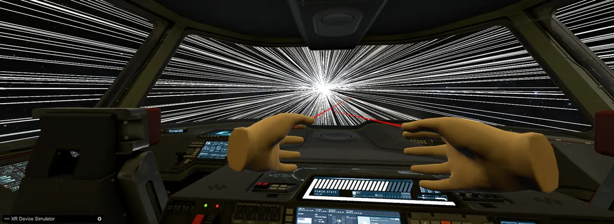
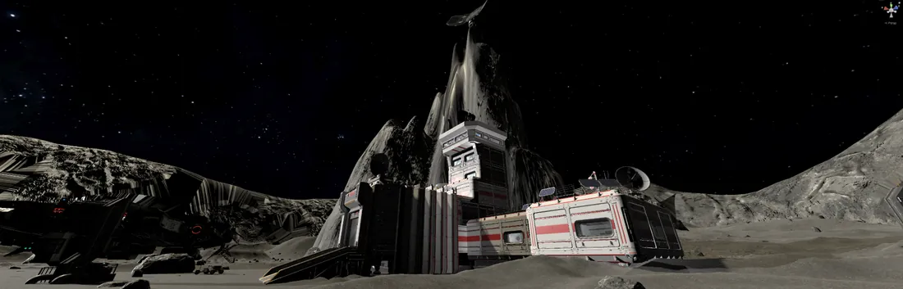
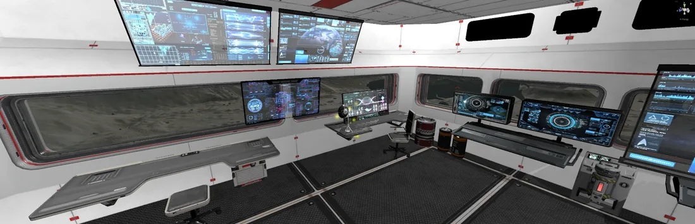

<a href="https://thibautplatet.com/en/projects/solas.html"><picture><source media="(prefers-color-scheme: dark)" srcset="https://raw.githubusercontent.com/ThibPltt/ThibPltt/main/assets/repos/SOLAS-dark.svg"><source media="(prefers-color-scheme: light)" srcset="https://raw.githubusercontent.com/ThibPltt/ThibPltt/main/assets/repos/SOLAS-light.svg"></picture></a>

# SOLAS

Serious game for learning astronomy in VR.

| At a glance | |
|---|---|
| **Dates** | 2024 – 2025 |
| **Context** | virtual reality · project lead, team of 4 · ENSIM |
| **Technologies** | VR · Unity · C# · Blender |
| **Video** | [Gameplay video on YouTube](https://www.youtube.com/watch?v=2curbw4u178) |
| **Case study** | [thibautplatet.com/en/projects/solas.html](https://thibautplatet.com/en/projects/solas.html) |

## Problem

Give a young audience some scientific culture about the solar system, using the immersion of virtual reality to convey the vastness of space.

## Role

Project lead, team of 4.

## Decisions

A fixed route from planet to planet rather than free exploration, which was too heavy to build; three surfaces to land on (Moon, Mars, Earth); a text and a voice-over for each planet.

## Result

A complete game, from the menu to the final scene, tested on Meta Quest 3. A first version was tried by many visitors at the ENSIM open day (25 January 2025).

## My contribution

- A large part of the game’s C# scripts.
- The “light speed” loading screen: about 800 thin objects arranged in a cone and spun at high speed by a C# script, triggered when the engines start.
- The Moon scene: terrain built from scratch and textured with craters, lunar base, a satellite dish to collect flagged by a light animation, invisible walls at the edges, landing button.
- Blender modelling of the ship’s kitchen, engines, battery and satellite dish.
- Research and educational texts on the Earth, Jupiter and the asteroid belt; voice-over recording.

## Specification

| Requirement | Answer |
|---|---|
| **Audience** | Young people curious about astronomy: for each planet, a short text and a voice-over while the player looks at the planet. |
| **Immersion** | A virtual reality game: objects are grabbed by hand from the cockpit; travel uses a keypad and “Start engines” and “Land” buttons. |
| **Progression** | The ship has been hit by an asteroid: at each stop there is a part to collect, and the ship is rebuilt as the adventure goes on. |
| **Exploration** | Three surfaces to land on and walk around freely: the Moon, Mars and the Earth. |
| **Atmosphere** | Original music, sound effects, and a loading screen that simulates speed between two planets. |
| **Testing** | Unity’s XR simulator to iterate quickly, then a Meta Quest 3 headset to validate the real experience. |
| **Complete project** | Carried over one year by a team of four: scenario, modelling, development, testing. |

## The player’s journey

A fixed order, from planet to planet: the initial idea of a free route was dropped because it multiplied the scenes and required a save system.

Main menu → asteroid belt → Mars (surface to explore) → Jupiter → Moon (surface to explore) → Earth (surface to explore) → Mercury → Venus → Saturn → Uranus → Neptune → final scene.

## In pictures

From the cockpit, the missing part is grabbed by hand (here an engine, in the asteroid belt).

Each planet is introduced by a text and a voice-over (in French).

The cockpit keypad: planets unlock as parts are collected.

The “light speed” loading screen, between two planets.

The lunar base, on terrain sculpted for the scene.

Inside the lunar base, where the satellite dish to bring back to the ship is found.

## Results

| | |
|---|---|
| **10** | stops: the asteroid belt, the Moon and the eight planets |
| **3** | surfaces to explore on foot |
| **≈ 800** | animated objects for the speed effect |
| **1 year** | of work, as a team of four |

A complete game, from the main menu to the final scene, played through in full by all four team members on a Meta Quest 3. A first stable version was shown at the ENSIM open day on 25 January 2025: many visitors tried it and shared their impressions.

## Controls

| Action | Control |
|---|---|
| Move | Left joystick |
| Look around | Right joystick |
| Grab / interact | Trigger |
| Menu / pause | Menu button |

## Run it

Open the project with Unity **2022.3.50f1** (XR Interaction Toolkit 2.6, OpenXR), check the headset in *Project Settings › XR Plug-in Management*, open `Assets/Scenes/MainMenu.unity` and press **Play** with the headset connected. Each stop has its own scene in `Assets/Scenes/` (`Mars`, `MarsSurface`, `Jupiter`, `Lune`, `LuneSurface`, `Terre`, `TerreSurface`…), and the scripts are grouped by feature in `Assets/Scripts/` (`KeyPad`, `ChangementScene`, `VoixOff`, `Moon`, `Mars`, `Terre`, `Menu`…).

## Credits

Project led by Thibaut Platet with Adélie Brunel, Arthur Lecureur and Pauline De Vittori, ENSIM (Interaction Personnes-Systèmes, 4th year). The full history comes from the team’s original repository, [Lecureur-Arthur/SOLAS](https://github.com/Lecureur-Arthur/SOLAS); its French README is kept in [README.fr.md](README.fr.md). Models, textures and sounds from the Unity Asset Store (lunar base, asteroids, ship, landscapes) keep their own licences.
